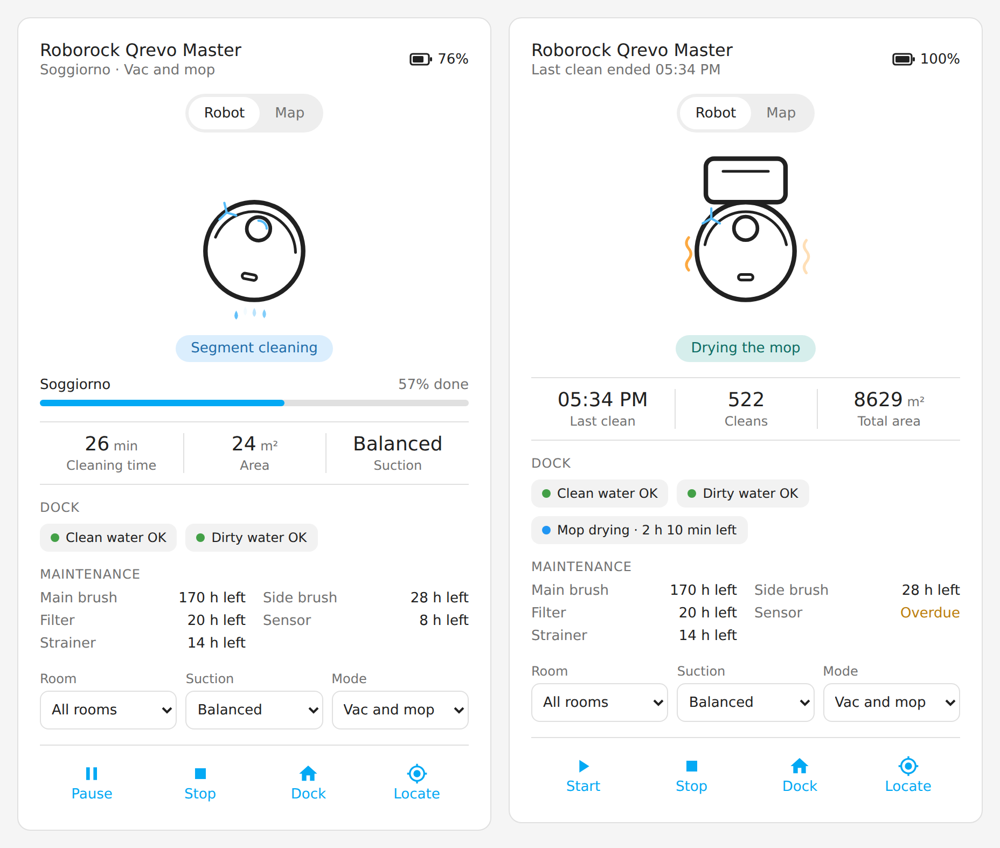
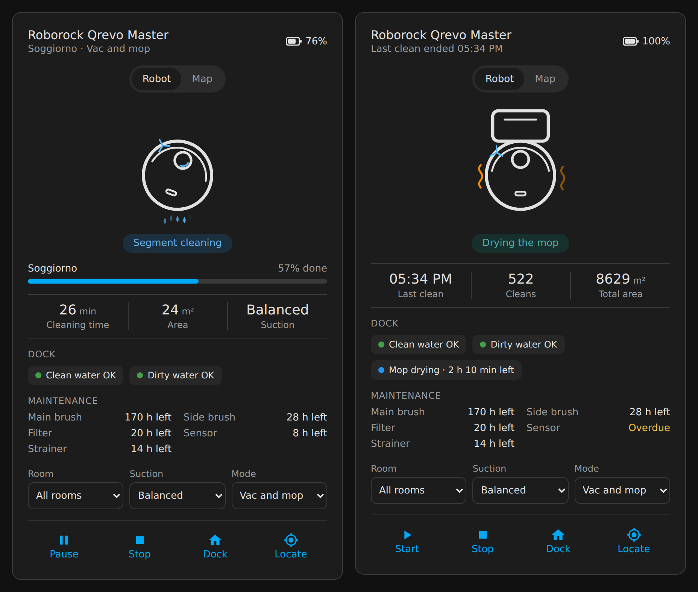

# Roborock Vacuum Card

<p align="center"></p>

A Home Assistant dashboard card for Roborock robot vacuums: what the robot is doing, which room
it's in and how far along, the map, the dock (water tanks, mop drying), consumables, and the
controls to start a room, change suction and mode, pause, stop, dock and locate.

It reads the entities of Home Assistant's built-in **[Roborock integration](https://www.home-assistant.io/integrations/roborock)**,
and works with any Roborock vacuum that integration supports, with or without a dock. What a
model doesn't have, the card leaves out.

## What it shows





- **Status** with its own animated icon: cleaning or mopping, returning, charging, docked,
  emptying the bin, washing the mop, drying the mop, paused, error. The label is the
  integration's own status, translated by Home Assistant into your language, so every status
  of every model reads correctly; a status the card doesn't know falls back to the vacuum's
  state for the icon.
- **Battery**, in orange at 20 % or less.
- **Room and progress** while cleaning: the current room, percentage done, cleaning time,
  area and suction. When idle: the last clean, total cleans and total area.
- **Map**: the integration's map image of the selected map, behind the Robot | Map switch.
- **Dock**: clean water, dirty water, water shortage, and mop drying with the time left. An
  **Empty bin** button appears on models that have one (the Q10).
- **Errors**: robot and dock errors in a banner, with **Resolve** for a dock error.
- **Maintenance**: hours left for the main brush, side brush, filter, sensors, dock strainer
  and mop, in orange when overdue and amber when nearly due. Tap one to reset it from its
  details.
- **Controls**: room, suction and mode, then Start (or Resume), Pause, Stop, Dock and Locate.
  With a room chosen, Start cleans only that room.

Tap the card to open the vacuum's details. Animations stop when the system asks for reduced
motion. Card text is in English or Italian, following your Home Assistant language.

### Rooms

The room list uses Home Assistant areas: in the vacuum entity's settings, match each Roborock
room to an area. The card then lists those areas and
starts a room with the standard `vacuum.clean_area` action. Without a mapping the room list is
hidden and Start cleans everywhere.

<!-- ha-marketplace:exclude-start -->
## Install

[](https://my.home-assistant.io/redirect/marketplace_repository/?owner=enricodeleo&repository=roborock-vacuum-card&category=plugin)

In Home Assistant 2026.11 or newer: **Settings → Marketplace → Add from link**, then enter
`enricodeleo/roborock-vacuum-card`. Adding a link needs a one-time GitHub sign-in.

Manual install: copy `dist/roborock-vacuum-card.js` to `/config/www/`, and add
`/local/roborock-vacuum-card.js` as a JavaScript module resource.
<!-- ha-marketplace:exclude-end -->

## Configuration

Add it from the card picker ("Roborock Vacuum Card"), or in YAML:

```yaml
type: custom:roborock-vacuum-card
entity: vacuum.roborock_qrevo_master
```

| Option | Required | Description |
|---|---|---|
| `entity` | yes | The Roborock vacuum entity |
| `name` | no | Card title (default: the vacuum's name) |
| `hide_controls` | no | Hide the room, suction and mode lists and the buttons (default `false`) |
| `hide_maintenance` | no | Hide the maintenance section (default `false`) |
| `status`, `battery`, `vacuum_error`, `dock_error`, `current_room`, `progress`, `cleaning_time`, `cleaning_area`, `last_clean_end`, `total_count`, `total_area`, `cleaning_mode`, `selected_map`, `mop_attached`, `mop_drying`, `mop_drying_remaining`, `clean_water`, `dirty_water`, `water_shortage`, `resolve_dock_error`, `empty_bin`, `map` | no | Override an entity. By default they are found on the vacuum's device and its dock device by the integration's names. Set them only if that fails |

## Development

```bash
npm ci
npm run watch      # rebuilds dist/roborock-vacuum-card.js on change
npm run typecheck
```

`dist/` is committed, so the Marketplace can install from the default branch. CI checks it
matches `src/`. To release:
1. Bump `version` in `package.json` and run `npm run build`.
2. Commit, then publish a GitHub release tagged `v<version>`.

The release workflow attaches the built file to the release.

## License

MIT. The robot vacuum artwork and state icons are part of this project. Roborock is a
trademark of its owner; this card is not affiliated with it.
